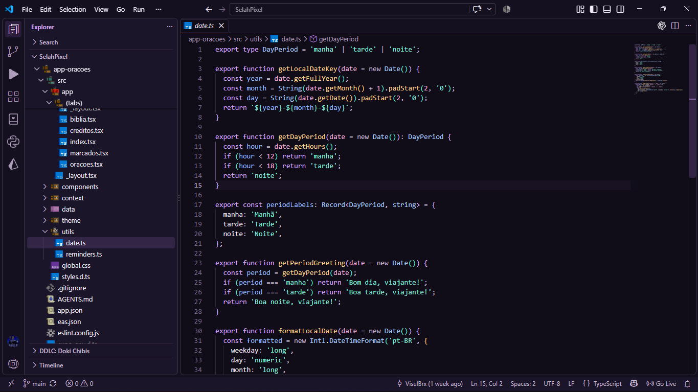
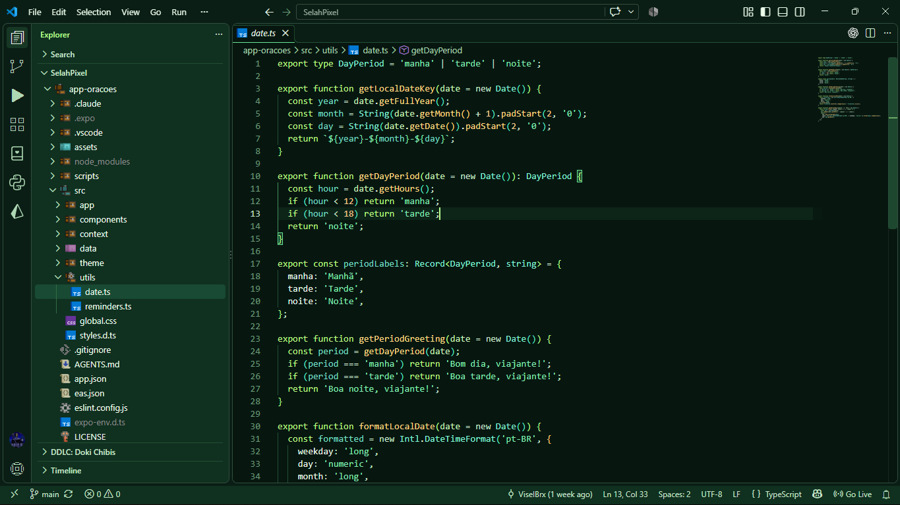
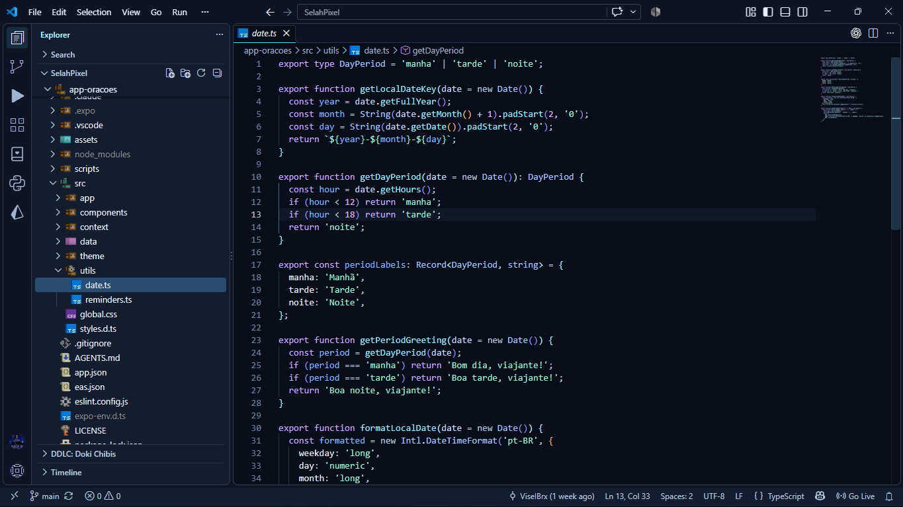
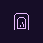
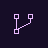
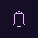

# Dark Fantasy Extension

Dark Fantasy Extension brings three dark color themes and a pixel art product icon theme to VS Code. The palette draws on grimoires, alchemy, glowing crystals, and spectral magic while keeping code readable.

## Color themes

| Theme | Look | Main colors |
| --- | --- | --- |
| **Vespergrim** | Candlelit grimoires and violet potions | Violet, lavender, teal, and amber |
| **Myrkwood** | Forest herbs and luminous alchemy | Deep green, emerald, lime, and amber |
| **Noxthar** | Spectral magic and the abyss | Deep blue, icy cyan, and violet |

Each theme styles the workbench, editor, syntax, terminal, selections, diagnostics, and Git decorations.

## Screenshots (TypeScript exemple)

### Vespergrim

### Myrkwood

### Noxthar

## Product icons

**Vespergrim Relics** replaces 14 workbench symbols with custom pixel art, including Explorer, Search, Source Control, Run, Extensions, Terminal, Settings, Testing, Accounts, Notifications, Outline, Output, Remote Explorer, and Debug. The icons share a 24 × 24 grid for consistent alignment in the Activity Bar.

These previews show the actual product icon designs at Activity Bar size, using Vespergrim's foreground and background colors.

| Explorer | Search | Extensions | Settings | Accounts | Remote | Debug |
|:---:|:---:|:---:|:---:|:---:|:---:|:---:|
|  |  |  |  |  |  |  |

| Source Control | Run | Terminal | Testing | Notifications | Outline | Output |
|:---:|:---:|:---:|:---:|:---:|:---:|:---:|
|  |  |  |  |  |  |  |

The same icons work with all three color themes, and their color follows the active theme. VS Code loads product icons from a WOFF font generated from the designs in `scripts/icon-designs.mjs`. SVG versions live in `design/pixel-icons/`; this README uses PNG previews for Marketplace compatibility. **File and folder icons are not included.**

## Visual details

Words under the cursor, matches, search results, and symbols use subtle colored outlines and translucent highlights. Tabs, sidebars, and syntax accents use brighter colors against dark backgrounds.

## Installation

In VS Code, search for **Dark Fantasy Extension** in the Extensions view and select **Install**. Open **Preferences: Color Theme** to choose **Vespergrim**, **Myrkwood**, or **Noxthar**. For the pixel art workbench icons, open **Preferences: Product Icon Theme** and select **Vespergrim Relics**.

To install a downloaded VSIX instead, use **Extensions: Install from VSIX...** in the Command Palette.

## License

This project is licensed under the [MIT License](LICENSE). Copyright © ViselBrx.
